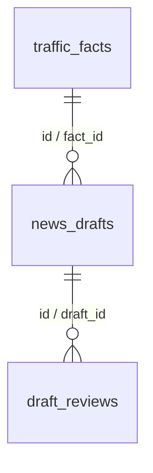

# 2차 과제: 서울 교통정보 뉴스 미니 서비스

> 독립 과제 저장소. 기존 [traffic_app_domain](https://github.com/gamzpot96-cell/traffic_app_domain)의 `kakao` 브랜치, Supabase, 관리자 인증을 변경하지 않습니다.

## 프로젝트 현황 (2026-10-20)

**개발 중 / 인터넷 공개 배포 금지**. FastAPI + MySQL 8 + Kakao Local/Mobility + OpenAI API를 사용하는 교통정보 기사 생성 실습입니다. 기사 자동 승인이나 실측하지 않은 자료의 생성은 금지합니다.

| 항목 | 현재 상태 |
|---|---|
| 기능정의/DB 설계 | 코드·SQL 작성 |
| F01 MySQL 교통 Fact CRUD | 코드 작성, 실제 MySQL 검증 대기 |
| F02 Fact Sheet | 구현·모의 검사 |
| F03 실제 AI API 기사 초안 | 연동 코드, 외부 실호출 대기 |
| F04 사람 검수 | API 코드, 실 DB 검증 대기 |
| F05 실패 검수 승인 차단 | 코드·모의 테스트 통과, 인증 기능 미구현 |
| Kakao 자동차 경로 수집 | 명시적 호출용 코드, 실제 호출 대기 |
| 전체 자동 테스트 | 로컬 Python 3.13 환경에서 unittest **5개 통과**; Windows Python 3.10 및 실 DB는 미검증 |
| GitHub | 과제 단계별 커밋 기록 |
| Vercel | 미배포 |

## 기획·화면 설계

- 도메인: 서울의 **선택한 자동차 경로** 교통정보. 서울 전체 도로 실황이나 교통 원인을 일반화하지 않음
- 핵심 메시지: 특정 시점 조회한 거리·예상 주행시간에 출처와 한계를 붙여 뉴스 **초안** 작성
- 독자: 서울 자동차 경로 이용자와 데이터 뉴스 학습자
- 화면: FastAPI `/docs`를 과제 단계별 CRUD·생성·검수·승인 **API 조작 화면**으로 사용. 별도의 메인/검수 HTML GUI는 아직 미구현
- 데이터: Kakao Local 장소 검색 및 Kakao Mobility 자동차 경로 응답. 조회 시각은 API 조회를 완료한 시각이며 도로 센서 관측시각이 아님

| ID | 기능 | 입력 → 출력 |
|---|---|---|
| F01 | 교통 Fact CRUD | 경로 정보 → MySQL 저장·수정·삭제·조회 |
| F02 | Fact Sheet | 저장된 경로 → 출처/시각/수치 구조화 |
| F03 | AI 기사 초안 | Fact Sheet → AI 제목·본문, 상태 review |
| F04 | 검수 | 사람이 기사와 Fact Sheet 비교 → passed 및 검수 메모 |
| F05 | 승인 차단 | 최신 검수 실패 또는 없음 → HTTP 400, 성공하면 승인 |

## MySQL 설계



각 테이블의 `id`가 PK. `news_drafts.fact_id`와 `draft_reviews.draft_id`는 FK. 정확한 타입/제약 조건은 [schema.sql](schema.sql)을 참조하세요. 삭제 시 뉴스 초안과 연결된 교통 Fact 보존을 위해 RESTRICT 적용.

## Windows 11 PowerShell 실행

작업 폴더에서 순서대로 실행합니다.

```powershell
py -3.10 -m venv .venv
.\.venv\Scripts\python.exe -m pip install -r requirements.txt
Copy-Item .env.example .env
# MySQL Workbench에서 schema.sql을 실행한 후, .env에 본인 정보 직접 설정
.\.venv\Scripts\python.exe -m unittest discover -s tests -v
.\.venv\Scripts\python.exe -m uvicorn app.main:app --host 127.0.0.1 --port 8000 --reload
```

로컬 API 실습 화면: http://127.0.0.1:8000/docs

1. `POST /collect`로 Kakao 조회·저장(키/DB 준비 후) 또는 `POST /facts`로 **출처가 확인된** Fact 등록.
2. `GET /facts`, `GET /facts/{id}`로 근거 조회, `PUT /facts/{id}`와 `DELETE /facts/{id}`로 CRUD 확인.
3. `POST /drafts`로 AI 기사 초안 생성. **OPENAI_API_KEY와 외부 API 호출 비용 필요**.
4. 사람이 근거 대조 후 `POST /drafts/{id}/review`로 검수 결과 입력.
5. `POST /drafts/{id}/approve`: 실패/미검수면 HTTP 400, 승인 가능한 경우에만 approved 처리.

**경고:** 현재 검수자 로그인·권한 확인 기능이 없습니다. 승인 엔드포인트를 인터넷에 공개 배포하지 마세요. 검수 성공 여부는 사람이 입력하며 수치 자동 대조 엔진은 구현 전입니다. 비밀키는 `.env`에서만 관리하며 커밋하지 마세요.

## Notion 과제 별도 결과

- [원본 기사 DB](https://app.notion.com/p/69183fcaeb04469d8512d2ed5da206a3) — 기사 3건 등록
- [생성 기사 DB](https://app.notion.com/p/72ea9af9499c4a1e98b876653ba42920) — v1/v2 비교 기사, 둘 다 검토대기
- 예약 작업: 매일 한국시간 오전 9시 설정, **최초 실제 실행 결과 검증 대기**. Notion 외부 공유 권한 검증 대기.

## 과제 제출 전 검증 필요

MySQL SELECT 5건 및 CRUD/재시작 실측, Kakao 실호출, OpenAI 모델 응답, 승인 실패/성공 실제 화면, 사람 검수 기록, Notion 예약 실행 기록, 제출용 외부 공유 링크와 ChatGPT 대화 공유 링크 확인이 필요합니다. 실행하지 못한 항목은 **미구현·미검증**으로 구분합니다.
